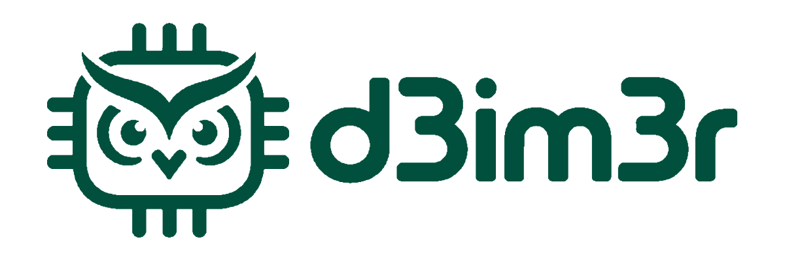
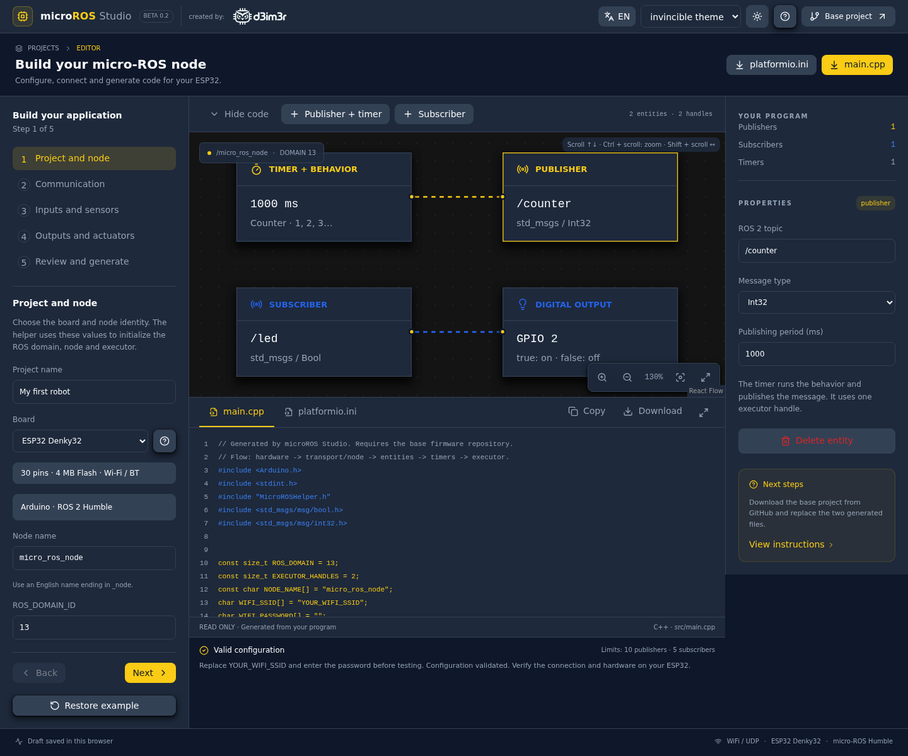

<div align="center">
  <picture>
    <source media="(prefers-color-scheme: dark)" srcset="public/brand/d3im3r/horizontal-dark.svg" />
    
  </picture>
  <h1>microROS Studio · Beta 0.2</h1>
  <p>An interactive micro-ROS firmware builder for ESP32 boards.</p>
  <p>Created by <a href="https://github.com/d3im3r">d3im3r</a></p>
  <p>
    <a href="https://nextjs.org/"></a>
    <a href="https://react.dev/"></a>
    <a href="https://www.typescriptlang.org/"></a>
    <a href="https://tailwindcss.com/"></a>
    <a href="https://ui.shadcn.com/"></a>
    <a href="https://nodejs.org/"></a>
  </p>
  <p>
    <a href="https://docs.ros.org/en/humble/"></a>
    <a href="https://micro.ros.org/"></a>
    <a href="https://platformio.org/"></a>
    <a href="https://vercel.com/"></a>
  </p>
</div>

Build a micro-ROS application through a guided hardware wizard and a visual program diagram. Download **only `platformio.ini` and `main.cpp`**, then use them with the [base firmware project](https://github.com/d3im3r/esp32-microros-template).



## Features

- Five-step wizard: project and node, communication, inputs, outputs, review.
- 27 sensor and actuator profiles with editable GPIOs and device settings.
- Board-specific GPIO, ADC1, touch, UART, I2C and PWM validation.
- Local board pinout images, specifications and pin capability tables.
- Visual diagram with pan, zoom, fit view and fullscreen controls.
- Generated C++ and INI previews with copy, download and expanded code view.
- Light/dark mode and Default, invincible theme and Clean Slate palettes.
- Browser-local drafts; WiFi passwords are excluded from saved drafts.
- English/Spanish interface with a persistent language toggle; generated firmware and suggested identifiers stay in English.
- Optional joystick button, VL53L0X XSHUT and TB6612FNG STBY pins.
- Named GPIO constants for all hardware profiles, including the shared I2C bus.

The starter program publishes `/counter` every second and subscribes to `/led` using `std_msgs/Bool`. Suggested node names end in `_node`, and topics start with `/`. The UDP Agent port is fixed at **8888**.

## Beta 0.2

Use the **EN / ES** button in the header to change the interface language. The preference is stored in your browser. Switching languages preserves your draft, project name, node name, topics and generated firmware.

Choose **Not connected** in an optional pin selector to release that GPIO:

- **Joystick button:** only the X/Y axes are read; message `z` stays at `0`.
- **VL53L0X XSHUT:** available for one sensor at the default `0x29` address. Multiple sensors require separate XSHUT GPIOs for safe startup address assignment.
- **TB6612FNG STBY:** wire STBY high externally when it is not GPIO-controlled. The generated watchdog still stops PWM and direction outputs.

Catalog names identify the sensing technology or actuator function, alongside the model. Labels distinguish infrared ToF from ultrasonic distance sensors, 6-axis from 9-axis inertial sensors, and motor drivers from motors.

Firmware constants use the device type and a per-type instance number, independent of topic names or unrelated blocks. For example:

```cpp
const uint8_t led1 = 2;
pinMode(led1, OUTPUT);

const uint8_t driver_tb1_IN4 = 16;
pinMode(driver_tb1_IN4, OUTPUT);
```

## Run locally

Use **Node.js 22** and npm.

```bash
nvm use
npm ci
npm run dev
```

Open [localhost:3000](http://localhost:3000). Without nvm, install Node.js 22 directly.

## Build your firmware

1. **Project and node:** select a board, project name, node name and ROS domain.
2. **Communication:** configure WiFi/UDP or Serial, the Agent IP and the shared I2C bus.
3. **Inputs and sensors:** add devices and adjust their settings in Properties.
4. **Outputs and actuators:** choose outputs and configure GPIOs, addresses and polarity.
5. **Review and generate:** resolve resource conflicts, inspect the code and download both files. **Next steps** opens the base-project and Agent instructions.

Clone or download the [base firmware repository](https://github.com/d3im3r/esp32-microros-template), then replace:

```text
base-firmware/
├── platformio.ini         ← generated platformio.ini
├── src/
│   └── main.cpp           ← generated main.cpp
├── include/
│   └── MicroROSHelper.h   ← keep from the base project
└── lib/
    └── micro_ros_platformio/ ← keep from the base project
```

Open the base project in PlatformIO, start the micro-ROS Agent, and build/upload locally. The web app generates source files; it does not compile, flash or connect to your robot.

For the default WiFi setup:

```bash
source /opt/ros/humble/setup.bash
export ROS_DOMAIN_ID=13
ros2 run micro_ros_agent micro_ros_agent udp4 --port 8888
```

The app generates matching commands for your selected domain and transport.

## Supported boards

| Board | PlatformIO target | Default I2C SDA / SCL |
| --- | --- | --- |
| ESP32 Denky32 | `denky32` | 21 / 22 |
| ESP32-CAM AI-Thinker | `esp32cam` | 13 / 14 |
| TTGO T-Camera ESP32-WROVER-B | `esp32dev` with PSRAM flags | 21 / 22 |
| Seeed Studio XIAO ESP32-S3 Sense · OV3660 | `seeed_xiao_esp32s3` | 5 / 6 |
| ESP32-C3 SuperMini | Compatible `esp32-c3-devkitm-1` profile | 8 / 9 |
| ESP32 D1 Mini / ESP32-S | `wemos_d1_mini32` | 21 / 22 |

Denky32 uses the user-confirmed `denky32` build target and a DOIT DevKit V1 reference pinout. XIAO Sense targets the OV3660 revision. D1 Mini targets the 40-contact ESP32 model, not the ESP8266. Confirm your physical board revision against its pinout.

Changing the board preserves existing GPIO assignments and reports incompatible ones. A default I2C bus follows the new board; a custom bus remains available for review. Cameras, microphones and microSD are not initialized automatically.

## Device catalog

### Inputs and sensors

| Device | Published data |
| --- | --- |
| Capacitive touch input | Int32 raw reading; ESP32 decreases on touch, S3 increases |
| Internal temperature sensor | Float32 °C from the silicon, not ambient temperature |
| LM35 | Float32 °C, calibrated ADC millivolts / 10 |
| Infrared ToF distance sensor · VL53L0Xv2 | Float32 meters; -1 for invalid readings |
| Ultrasonic distance sensor · HC-SR04 | Float32 meters; -1 for no echo, 25 ms timeout |
| 6-axis inertial sensor · MPU-6050 | Vector3 acceleration x/y/z in m/s² |
| 9-axis orientation sensor · BNO055 | Float32 yaw in radians |
| Incremental quadrature encoder | Int32 signed count |
| Analog position input · Potentiometer | Int32 12-bit ADC1, 0–4095 |
| Temperature and humidity sensor · DHT11 | Vector3 temperature / humidity / validity |
| 2-axis analog joystick | Vector3 ADC x / ADC y / button |
| Generic analog input · ADC | Int32 ADC1 reading |
| Generic digital input · GPIO | Bool logic level |

### Outputs and actuators

| Device | Received command |
| --- | --- |
| Active buzzer | Bool on/off |
| I2C character LCD · 16×2 | Int32 displayed value; PCF8574/PCF8574A |
| 28BYJ-48 + ULN2003 | Int32 absolute half-step target; nonblocking motion |
| LED matrix + driver · MAX7219 | Int32 0–64 lit LEDs on one FC-16 8×8 module |
| PWM servo motor | Int32 0–180°; 50 Hz PWM |
| LED · Digital output | Bool on/off |
| RGB LED · PWM | Vector3 red/green/blue, 0–255 |
| SSD1306 OLED | Int32 value on a 128×64 I2C display |
| SH1106/SH110x OLED | Int32 value using a 128×64 SH1106G profile |
| 4-digit LED display · TM1637 | Int32 -999 to 9999; dedicated CLK/DIO |
| Dual H-bridge motor driver · L298N | Vector3 signed motor A/B percentages; z reserved |
| Dual H-bridge motor driver · TB6612FNG | Vector3 signed motor A/B percentages; STBY and watchdog |
| Generic digital output · GPIO | Bool state with configurable polarity |
| Generic PWM output | Int32 duty cycle, 0–255 at 1 kHz |

Profiles provide starting configurations. Check module voltage, wiring, address jumpers and device notes. LM35, touch and analog profiles are disabled where the board does not expose the required pins. Touch is unavailable on C3 and this TTGO profile.

## Resource validation

- Up to 12 entities, within the base helper limits of 10 publishers and 5 subscribers.
- Duplicate GPIOs, incompatible pin capabilities and repeated I2C addresses block downloads.
- I2C devices share SDA/SCL; those pins cannot also serve unrelated signals.
- Each VL53L0X gets an independent XSHUT pin and a coordinated startup address.
- Analog input uses ADC1 for WiFi compatibility. GPIO logic is 3.3 V.
- Servo PWM uses separate channels/timers from LED and motor PWM. ESP32 offers 14 additional PWM channels, S3 6 and C3 4, plus up to two servo channels.
- `/led_builtin` identifies the real onboard LED GPIO. Digital LED selection applies its polarity. TTGO has no onboard LED available in this profile.
- DC motor watchdogs run before the WiFi guard. Blocking sensor calls can still affect timing; this is not a real-time safety controller.

For micro-ROS Serial, the base helper uses `HardwareSerial`. C3 requires UART TX21/RX20 and XIAO TX43/RX44 through a 3.3 V USB–TTL adapter with common GND. Their native USB remains available for uploading firmware.

## Generated configuration and diagnostics

The minimal INI includes the board, Arduino, monitor speed, micro-ROS transport/distribution and only the dependencies required by selected devices. It retains `espressif32@6.13.0` for the tested Arduino 2.x APIs. CPU and Flash settings come from the board manifest. TTGO retains PSRAM flags, XIAO retains its CDC correction, and CAM disables monitor DTR/RTS.

WiFi programs report node name, domain, SSID, Agent IP/port, hardware setup, ready entities and **Node ready** through the serial monitor at 115200 baud. The password is never printed. WiFi loss is reported immediately and then at most once per second; recovery is reported once. Monitoring does not recreate an Agent session. Serial transport suppresses text logs on its binary protocol port.

## Tests and production build

```bash
npm run typecheck
npm test
npm run build
npx playwright install chromium
npm run test:e2e
```

Use `PLAYWRIGHT_CHROMIUM_EXECUTABLE_PATH=/path/to/chrome` to run browser tests with an existing Chrome installation. Playwright uses port 3101 and `.next-e2e`, separate from normal development. Test output and screenshots are ignored by Git.

Generator tests cover validation, dependencies, C++ syntax with API doubles, and simulated WiFi monitoring. Browser tests cover the wizard, persistence, themes, board profiles, diagram navigation and downloads. These checks do not replace building with PlatformIO and testing each physical circuit.

GitHub Actions runs type checking, generator tests, the production build and browser tests for pull requests and pushes to `main`.

## Deploy to Vercel

1. Push this web project to its own GitHub repository.
2. Import that repository in your Vercel account.
3. Use **Next.js**, root directory **`./`**, Node.js **22.x**, install command **`npm ci`**, and build command **`npm run build`**. Leave the output directory at the framework default.
4. No application environment variables are currently required. Leave `NEXT_E2E` unset in Vercel.
5. Deploy a preview, verify the wizard and downloads, then promote or deploy `main` to production.

These deployment instructions contain no credentials. Keep tokens and environment files out of Git; values prefixed with `NEXT_PUBLIC_` are visible to browser users. Local `.env*` files and `.vercel/` are ignored by Git.

A `.vercel.app` domain is sufficient initially. No database, user account service or ROS Agent is hosted by this app. Drafts belong to the browser origin and do not migrate automatically from localhost to the deployed domain.

## Feature-first architecture

```text
src/
├── app/                  # Next.js layout, metadata and global styles
├── features/
│   ├── project-wizard/   # Guided construction and final review
│   ├── device-catalog/   # Device profiles, allocation and properties
│   ├── program/          # Zod model, board capabilities and validation
│   ├── board-help/       # Local pinouts and pin capability tables
│   ├── connection/       # WiFi, Serial and shared I2C settings
│   ├── code-generation/  # C++/INI generation and diagnostics
│   ├── visual-editor/    # React Flow diagram and navigation
│   ├── properties/       # Selected entity configuration
│   ├── code-preview/     # Read-only source preview and expanded view
│   ├── export-files/     # File downloads
│   ├── help/             # Device help and deployment instructions
│   ├── project/          # Browser-local draft persistence
│   ├── language/         # Persistent English/Spanish interface preference
│   ├── theme/            # Palette and light/dark preferences
│   ├── robot-catalog/    # Compatibility with early saved blocks
│   └── workspace/        # Application composition
└── shared/               # UI primitives and utilities
```

## Author

**Deimer Miranda Montoya** · [d3im3r](https://github.com/d3im3r)

## Branding and credits

The official **d3im3r owl-chip** artwork is stored locally in `public/brand/d3im3r/` and used in the header and this README. Original proportions and colors are preserved. `source.json` records the upstream commit from [d3im3r-brand-assets](https://github.com/d3im3r/d3im3r-brand-assets). Brand files retain their original [license](public/brand/d3im3r/LICENSE) and [usage guidelines](public/brand/d3im3r/BRAND.md).

The browser favicon uses the fixed yellow CPU icon from the editor, independent of the selected theme. Its Lucide license is included in `public/icons/`.

Board pinouts are served locally from `public/boards/`, with attribution in the app and original image URLs in `sources.json`. See [third-party notices](THIRD_PARTY_NOTICES.md).
